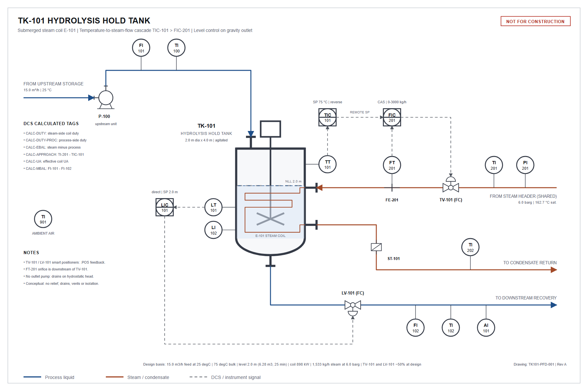

# TK-101 Hydrolysis Hold Tank: Process Description

This document describes the TK-101 unit, its control system and its
instrumentation, and explains how to read the historian data supplied
with it. It contains what an engineer needs to interpret the data from
first principles: equipment, physical relationships, control strategy,
how every tag and calculated value is defined, and how the instruments
and historian behave normally.

The data is a historian extract covering 90 days of continuous operation. Over that period the unit
experiences a number of abnormal events. This document does not
identify them: finding them, and establishing their causes from the
data, is the purpose of the dataset.

## Contents

1. Service and product requirements
2. Equipment and process flow
3. Design basis
4. Process physics
5. Control strategy
6. Instrumentation and tag list
7. Calculated (DCS) tags
8. Instrument and historian behaviour
9. Utilities and external influences
10. Neighbouring equipment in the extract
11. Data files

## 1. Service and product requirements

TK-101 is a continuous, agitated hold tank heated by a submerged steam
coil. It receives a dilute aqueous process stream (about 6 wt % dissolved
organics, the balance water) from upstream reaction storage, holds it at
temperature so that a residual intermediate completes hydrolysis, and
passes it on to downstream recovery.

Conversion depends on temperature and residence time together, and the
product specification is a temperature *window* rather than a minimum:

- **Too cold:** hydrolysis is incomplete within the available residence
  time and unconverted intermediate carries forward.
- **Too hot:** product thermally degrades to coloured by-products.

Product purity (mass fraction of desired product in the dissolved
organics) is described by the empirical correlation

```
purity [%] = 99.4 - 0.02 x (T - 78)^2      T = bulk temperature, degC
```

| Bulk temperature, degC | 60 | 65 | 70 | 75 | 78 | 82 | 88 |
|---|---|---|---|---|---|---|---|
| Purity, % | 92.92 | 96.02 | 98.12 | 99.22 | 99.40 | 99.08 | 97.40 |

The unit is normally operated at **75 degC**, deliberately on the cool
side of the 78 degC optimum: over-temperature damage is irreversible,
whereas unconverted material can be handled downstream. Sustained
operation below about 65 degC (purity below about 96 %) is off
specification.

The purity correlation is the only composition model. There is no species
balance, so purity cannot be reconciled against anything other than bulk
temperature.

## 2. Equipment and process flow

[](tk-101-hold-tank.svg)

*Click the image for the full-resolution SVG. Conceptual drawing, not to scale.*

On the diagram, transmitters carry ISA transmitter tags. Their readings are historised under the controller tags: `TT-101` is `TIC-101.PV`, `LT-101` (the primary level transmitter, LI-101) is `LIC-101.PV`, and `FT-201`, with its orifice plate `FE-201`, is `FIC-201.PV`.

- **TK-101**: vertical cylindrical vessel, 2.0 m diameter (3.14 m2 cross-section), 4.0 m tall,
  well mixed by an agitator, so the outlet is at bulk conditions.
- **E-101**: submerged steam coil. Steam from the site header passes
  through control valve TV-101, condenses in the coil, and the condensate
  drains through a steam trap to the condensate return system.
- **LV-101**: control valve on the single liquid outlet. The vessel
  drains under its own hydrostatic head; there is no outlet pump.
- **P-100**: centrifugal feed transfer pump, belonging to the upstream
  unit, that pumps from upstream storage to TK-101. It runs at fixed speed
  and TK-101 has no control over it. Its own instrumentation is on the
  upstream unit and is not in this extract; `FI-101` and `TI-100` are on
  the TK-101 inlet line, downstream of it.
- **Feed** is not controlled by this unit. It is whatever P-100 delivers
  from upstream storage; TK-101 accepts it and passes it on.
- There is one liquid outlet. `FI-102`, `TI-102` and `AI-101` are
  three instruments on the same product line.

## 3. Design basis

| Quantity | Value |
|---|---|
| Feed rate | 15.0 m3/h |
| Feed temperature | 25 degC nominal |
| Bulk temperature setpoint | 75 degC |
| Level setpoint | 2.0 m (6.28 m3 working volume) |
| Mean residence time at design | 25 min |
| Steam header pressure | 6.0 barg (162.7 degC saturation) |
| Latent heat at header conditions | 2,109 kJ/kg |
| Coil duty at design | 898 kW |
| Steam flow at design | 1,533 kg/h |
| Clean coil UA, steam valve fully open | 72 kW/K |
| TV-101 position at design | 50 % |
| LV-101 position at design | 50 % |
| Vessel heat loss coefficient | 500 W/K (about 28 kW at design) |
| Fluid density / heat capacity | 1000 kg/m3 / 4.18 kJ/kg.K (water-like; within 2-3 % for this stream) |

At the design point both control valves sit near mid-travel, leaving each
loop usable range in both directions.

## 4. Process physics

All the relationships below are the ones the unit actually obeys. Symbols:
h level (m), T bulk temperature (degC), A vessel cross-section (m2),
F flows (m3/s), x valve position as a fraction of travel (0-1).

### 4.1 Liquid inventory

```
A dh/dt = F_feed - F_out
F_out   = Cv x x_LV x sqrt(h)          Cv = 0.0059 m3/s = 21.24 m3/h per unit opening per m^0.5
```

Outflow is gravity-driven, so it rises with the square root of level as
well as with valve opening. At steady state the outlet flow equals the
feed flow and the level is constant; any persistent difference between
liquid in and liquid out must appear as a change in level.

### 4.2 Energy

```
rho cp V dT/dt = rho cp F_feed (T_feed - T) + Q_coil - UA_loss (T - T_ambient)
```

At steady state the coil supplies the sensible heat to raise the feed to
bulk temperature plus the vessel's heat loss to the surroundings
(UA_loss = 500 W/K).

### 4.3 Steam coil heat transfer

TV-101 throttles the steam admitted to the coil: the further it opens, the
higher the pressure and condensing temperature inside the coil and the
more of the coil is working. The combination of valve and coil therefore
behaves as an equal-percentage heat-transfer element. With the coil in its
as-commissioned condition, the heat delivered is

```
Q_coil = UA_clean x R^(x_TV - 1) x (T_sat - T)        UA_clean = 72 kW/K,  R = 50
```

where `T_sat` is the saturation temperature of the header steam and `x_TV`
is the TV-101 position (fraction). The term `UA_clean x R^(x_TV - 1)` is
the coil's *effective* UA at that valve position: about 10,239 W/K at the design position of 50 %, rising to 72,000 W/K at
full travel. Rearranged, it gives the valve position the coil should need
for a given duty:

```
x_TV,expected = 1 + ln( Q_coil / (UA_clean x (T_sat - T)) ) / ln(R)
```

Steam is consumed at `w_steam = Q_coil / h_fg(T_sat)`. All condensed
steam leaves through the trap as condensate.

### 4.4 Steam properties

The plant uses the following correlations (DCS calculations use the same):

```
T_sat [degC]   = 100 x (P_header [barg] + 1.013)^0.25
h_fg  [kJ/kg]  = 2500 - 2.4 x T_sat [degC]
```

Both fall as header pressure falls: lower pressure means a lower
condensing temperature and therefore less driving force across the coil.

### 4.5 Condensate

With the coil draining normally the steam trap discharges condensate a
little below saturation: `TI-202` reads about 5 K below `TI-201`
(after the 4-minute transport delay on the condensate line).

### 4.6 Product line

The vessel is well mixed, so product temperature equals bulk temperature
(`TI-102` = `TIC-101.PV` after the 3-minute line delay) and product purity
follows the correlation in section 1 at bulk temperature.

## 5. Control strategy

Three PI controllers. Mode codes on every `.MODE` tag: **0 = MAN, 1 = AUTO,
2 = CAS** (remote setpoint from a master controller).

| Loop | Normal mode | Measured variable | Manipulated | Action | Gain (Kc) | Integral (Ti) |
|---|---|---|---|---|---|---|
| TIC-101 | AUTO (1) | TIC-101.PV, degC | FIC-201.SP | reverse | 4.5 % output per degC (135 kg/h per degC) | 15 min |
| FIC-201 | CAS (2) | FIC-201.PV, kg/h | TV-101 | reverse | 0.015 % output per kg/h | 1 min |
| LIC-101 | AUTO (1) | LIC-101.PV, m | LV-101 | direct | 200 % output per m | 10 min |

None of the loops use derivative action. Controllers execute every
10 s scan. Integrators are clamped at the output limits
(0-100 %), and mode changes are bumpless. Setpoints change only by operator
entry, except where a loop is in cascade.

### 5.1 Temperature: TIC-101 cascaded onto steam flow FIC-201

TIC-101 does not move the steam valve. Its output is the setpoint of the
steam flow controller FIC-201, mapped linearly:

```
FIC-201.SP [kg/h] = 0 + (TIC-101.OP [%] / 100) x 3000
```

FIC-201 is a fast inner loop that moves TV-101 to deliver that steam flow.
TIC-101 is slow, tuned to the vessel's thermal time constant. The
practical consequences for reading the data:

- While both loops are in their normal modes, bulk temperature is held at
  setpoint and changes in heat demand appear in the steam flow
  (`FIC-201.SP` / `.PV`) and the steam valve (`FIC-201.OP`, `TV-101.POS`),
  not in the temperature.
- The inner loop also compensates for anything that changes how much
  steam flow, or how much heat, a given valve position produces. Such
  changes show up as a change in valve position for an otherwise
  unchanged steam flow.
- When TIC-101 is in MAN its output, and so the steam flow setpoint, is
  held at the last value; FIC-201 keeps controlling steam flow to it, and
  bulk temperature is no longer regulated.
- When FIC-201 is in MAN or AUTO the cascade is broken and TIC-101 no
  longer acts on the process.

### 5.2 Level: LIC-101

Level is controlled on the outlet, in the direction of flow: feed rate is
set upstream, so the tank absorbs mismatches in its inventory and passes
the flow on. LIC-101 is direct acting (level above setpoint opens LV-101)
and is deliberately tuned loosely. It is an inventory loop for surge
damping, not a quality loop, and tight tuning would pass every feed
fluctuation straight to the downstream unit.

Because outflow varies with `sqrt(h)`, the loop's process gain changes
with operating level.

### 5.3 Control valves

- **TV-101**: equal-percentage trim, rangeability 50 (see 4.3).
- **LV-101**: linear trim; flow per section 4.1.

Both valves have smart positioners. The controller output (`.OP`) is the
demand sent to the positioner. `TV-101.POS` and `LV-101.POS` are the
measured stem positions read back from the positioners, in the same 0-100 %
scale. A healthy positioner follows its demand within a few seconds
(3 s first-order response), so position and demand normally agree to
within the resolution of the readback.

## 6. Instrumentation and tag list

Every TK-101 tag in the historian. Ranges are the transmitter calibrated
ranges; readings are clamped to them. The *transport delay* is the pure
time delay between the vessel and the measurement point.

| Tag | Description | Units | Range | Instrument class | Transport delay | Notes |
|---|---|---|---|---|---|---|
| `TIC-101.PV` | Tank temperature | degC | 0 - 120 | temperature_slow | - | Bulk liquid temperature, thermowell in the vessel. Controlled variable of TIC-101. |
| `TIC-101.SP` | Tank temperature setpoint | degC | 0 - 120 | status | - | Operator-entered temperature setpoint. |
| `TIC-101.OP` | Tank temperature controller output | % | 0 - 100 | valve | - | Master output, 0-100 %. Written to FIC-201 as its setpoint (0-100 % = 0-3000 kg/h). |
| `TIC-101.MODE` | Tank temperature controller mode | - | 0 - 2 | status | - | Controller mode (0 MAN, 1 AUTO, 2 CAS). Normal: 1. |
| `FIC-201.PV` | Steam flow to coil | kg/h | 0 - 3000 | flow | - | Steam mass flow to the coil, orifice/DP meter downstream of TV-101. |
| `FIC-201.SP` | Steam flow setpoint | kg/h | 0 - 3000 | status | - | Remote setpoint from TIC-101 when in cascade; FIC-201.SP = 30 x TIC-101.OP. |
| `FIC-201.OP` | Steam valve demand | % | 0 - 100 | valve | - | Slave output: demand signal to the TV-101 positioner. |
| `FIC-201.MODE` | Steam flow controller mode | - | 0 - 2 | status | - | Controller mode (0 MAN, 1 AUTO, 2 CAS). Normal: 2. |
| `LIC-101.PV` | Tank level | m | 0 - 4 | level | - | Vessel level, primary DP-cell transmitter LI-101. Controlled variable of LIC-101. |
| `LIC-101.SP` | Tank level setpoint | m | 0 - 4 | status | - | Operator-entered level setpoint. |
| `LIC-101.OP` | Outlet valve demand | % | 0 - 100 | valve | - | Demand signal to the LV-101 positioner. |
| `LIC-101.MODE` | Level controller mode | - | 0 - 2 | status | - | Controller mode (0 MAN, 1 AUTO, 2 CAS). Normal: 1. |
| `TV-101.POS` | Steam valve position feedback | % | 0 - 100 | valve | - | Stem position feedback from the TV-101 positioner. |
| `LV-101.POS` | Outlet valve position feedback | % | 0 - 100 | valve | - | Stem position feedback from the LV-101 positioner. |
| `FI-101` | Feed flow from upstream storage | m3/h | 0 - 30 | flow | - | Feed volumetric flow, on the inlet line from upstream storage, downstream of feed pump P-100. |
| `TI-100` | Feed temperature | degC | 0 - 60 | temperature | - | Feed temperature, on the inlet line. |
| `FI-102` | Product flow | m3/h | 0 - 30 | flow | 2 min | Product volumetric flow, on the outlet line downstream of LV-101. |
| `TI-102` | Product line temperature | degC | 0 - 120 | temperature | 3 min | Product temperature, on the outlet line. |
| `LI-102` | Tank level, redundant transmitter | m | 0 - 4 | level | - | Vessel level, second independent DP-cell transmitter on separate taps. Indication only. |
| `PI-201` | Steam header pressure | barg | 0 - 12 | pressure | - | Steam header pressure, upstream of TV-101. |
| `TI-201` | Steam saturation temperature | degC | 0 - 220 | temperature | - | Steam temperature at the header (saturated steam), upstream of TV-101. |
| `TI-202` | Condensate return temperature | degC | 0 - 220 | temperature | 4 min | Condensate temperature on the condensate return line downstream of the coil's steam trap. |
| `TI-901` | Ambient temperature | degC | -30 - 50 | temperature | - | Ambient air temperature at the unit. |
| `AI-101` | Product purity analyzer (desired product in dissolved organics) | % | 90 - 100 | analyzer | 8 min | On-line purity analyzer on the product line (sample system and cycle time, see below). |

Valve positions and controller outputs are in percent of travel or
output. Mode tags are integers. Setpoint tags are written by the DCS.

## 7. Calculated (DCS) tags

The DCS computes these every scan from the *measured* values of the tags
above. It has no other knowledge of the process, so a calculated tag
inherits any error in its inputs. They are historised and compressed
like any other tag.

| Tag | Units | Definition |
|---|---|---|
| `CALC-DUTY` | kW | Steam-side coil duty: `FIC-201.PV / 3600 x (2500 - 2.4 x TI-201)` |
| `CALC-DUTY-PROC` | kW | Process-side duty: `FI-101 / 3600 x 1000 x 4.18 x (TIC-101.PV - TI-100)` |
| `CALC-EBAL` | kW | Energy balance gap: `CALC-DUTY - CALC-DUTY-PROC` |
| `CALC-APPROACH` | K | Steam-to-bulk temperature approach: `TI-201 - TIC-101.PV` |
| `CALC-UA` | W/K | Effective coil UA: `1000 x CALC-DUTY / CALC-APPROACH` |
| `CALC-MBAL` | m3/h | Liquid balance residual: `FI-101 - FI-102` |

Interpretation notes:

- `CALC-DUTY-PROC` is the sensible heat taken up by the feed only; it
  excludes vessel heat loss. At steady state `CALC-EBAL` therefore sits at a
  small positive value, not at zero: the vessel heat loss
  (`500 W/K x (T - T_ambient)`, about 28 kW at 20 degC ambient)
  plus the combined calibration offsets of the four instruments involved.
  In normal operation in this record it runs at roughly 33-37 kW as weekly
  averages, varying with ambient temperature. Transients in bulk
  temperature also move it, because stored heat is not included.
- `CALC-UA` is the *effective* UA at the current valve position (section
  4.3), about 10,239 W/K at design, not the clean full-open figure. While
  temperature is held at setpoint it is set mainly by the heat demand and
  the approach temperature.
- `CALC-MBAL` uses the product flow, which lags the vessel by 2 minutes,
  so it shows short-lived excursions whenever flows change. The level
  controller holds level, so liquid in and liquid out balance over any
  period long compared with the level loop's response. The two flowmeters
  are independent instruments and agree only to within their accuracy, so
  the long-run residual is a small offset rather than exactly zero.

## 8. Instrument and historian behaviour

### 8.1 Measurement characteristics by instrument class

Every transmitter adds the dynamics and noise of its class. Noise is
coloured (autocorrelated), not white. Readings are quantized by the
transmitter's digital resolution. Figures are fractions of the tag's span.

| Class | Sensor lag | Noise (1 sigma) | Noise correlation time | Resolution | Typical calibration drift | Update | Historian deadband |
|---|---|---|---|---|---|---|---|
| analyzer | 90 s | 0.50 % | 600 s | 0.195 % | 0.0400 %/day | 5 min | 0.60 % |
| calculated | - | inherited | inherited | - | inherited | every scan | 0.40 % |
| flow | 2 s | 0.60 % | 25 s | 0.024 % | 0.0040 %/day | every scan | 0.40 % |
| level | 8 s | 0.22 % | 90 s | 0.024 % | 0.0120 %/day | every scan | 0.30 % |
| pressure | 1.5 s | 0.40 % | 18 s | 0.024 % | 0.0030 %/day | every scan | 0.40 % |
| status (SP, MODE) | - | - | - | - | - | on change | on change |
| temperature | 45 s | 0.12 % | 240 s | 0.024 % | 0.0020 %/day | every scan | 0.15 % |
| temperature_slow | 120 s | 0.08 % | 420 s | 0.024 % | 0.0020 %/day | every scan | 0.15 % |
| valve | 3 s | 0.06 % | 30 s | 0.098 % | - | every scan | 0.20 % |

- **Flow** readings are noisy and fast (DP cells see real turbulence).
- **Temperature** readings are smooth and slow because the thermowell
  filters the process. `temperature_slow` is the heavy bulk-vessel
  thermowell.
- **Level** readings wander slowly, and each level transmitter's
  calibration drifts slowly and independently.
- **Analyzer** `AI-101` updates once every 5 minutes and holds its value
  between updates. It is coarsely quantized and carries an 8-minute
  sample-system delay on top of its 90 s response.
- **Valve positions and controller outputs** are clean, with a
  resolution of about 0.1 % of travel.
- Each transmitter has a small, slowly varying calibration offset of its
  own. Two instruments measuring the same thing therefore agree closely
  but not exactly, and the small gap between them can wander by a few
  tenths of a percent of span over months.

### 8.2 Data quality

- The `quality` field is **0 = good, 1 = uncertain, 2 = bad**.
- Each tag is served by one of several DCS I/O nodes (column `dcs_node` in
  `tags.csv`). Communication outages of a few minutes up to about
  1.5 hours occur occasionally; every tag on the affected node is marked
  bad for the same interval. In the long-format file the value recorded
  against a bad sample is not meaningful. In the regular grid bad samples
  are `NaN`.
- Isolated single-sample spikes occur occasionally on transmitters.
- A transmitter can occasionally stop updating and repeat its last
  reading for minutes to hours while still reporting good quality. A
  stuck reading shows as a perfectly flat line (or, in the compressed
  data, no stored values) on a tag that normally moves.
- These data-quality artifacts are a normal property of historian data
  and are not, in themselves, process events.

### 8.3 Historian compression

Analog tags are stored with swinging-door compression, each with its own
deadband (column `compression_deadband_pct` in `tags.csv`, percent of
span). A value is stored only when the signal departs from the line
through the last stored points by more than the deadband. As a result
**every tag has its own irregular timestamps** and there is no shared time
axis. Status tags (modes, operator setpoints) are stored only when they
change. The cascade setpoint `FIC-201.SP`, which changes every scan, is
compressed as an analog tag.

## 9. Utilities and external influences

**Steam header.** Shared with other plant units. Nominal 6.0 barg; it
wanders by about +/-0.10 bar over periods of half an hour or more as
other users swing, and has a daily cycle of about +/-0.07 bar
(highest in the early morning, lowest mid-afternoon, plant local time).
Saturation temperature follows header pressure (section 4.4).

**Ambient temperature** (`TI-901`). Follows the season (the record
starts in early spring and warms through it), a daily cycle of about
+/-6 degC peaking mid-afternoon local time whose size varies from day
to day with cloud cover, and multi-day weather swings of a few degrees. Ambient
reaches TK-101 through vessel heat loss and through the feed.

**Feed.** Flow averages 15 m3/h with short-term variability of about
+/-0.3 m3/h over periods of roughly 15 minutes, set by the upstream
unit. Feed temperature averages about 25 degC; it partly follows ambient
(through upstream storage, roughly 0.35 degC per degC of ambient
departure from its mean) and partly varies independently by about +/-0.8 degC
over hours.

Because the weather reaches many TK-101 tags at once, tags with no causal
connection to each other often correlate through ambient temperature.
Warmer weather means warmer feed and lower heat loss, so less steam is
needed and the steam valve sits lower.

## 10. Neighbouring equipment in the extract

The historian extract also contains tags from other equipment on the same
historian (60 tags in total, identified by the `unit` column of `tags.csv`):

- `CW-*`: Cooling water skid (CW-SKID), 5 control loops
- `N2-*`: Nitrogen header (N2-HDR), 4 control loops
- `SD-*`: Surge drum (SD-101), 4 control loops
- `AIR-*`: Instrument air (IA-SKID), 3 control loops

These units are not connected to TK-101 by any process stream or
utility other than sharing the same weather. Deciding which tags bear on a
given question is part of the analysis.

## 11. Data files

| File | Content |
|---|---|
| `historian.parquet` | Primary record. Long format, one row per stored value: `tag`, `timestamp` (UTC), `value` (float32), `quality` (int8). Compressed per tag, irregular timestamps. |
| `historian_60s.parquet` | Convenience wide table on a regular 1-minute grid (`timestamp` + one column per tag), reconstructed from the compressed record by linear interpolation between stored points. Bad-quality samples are `NaN`. It inherits the compression's reconstruction error. |
| `tags.csv` | Tag dictionary: description, units, range, instrument class, role (PV/SP/OP/MODE/IND/CALC), loop, DCS node, transport delay, compression deadband, sensor lag, update period, owning unit. |
| `PROCESS_DESCRIPTION.md` | This document. |

- The record starts at 2024-03-01 00:00 plant local time (America/Chicago) and runs for 90 days.
- **All timestamps are UTC.** Plant local time is US Central
  (America/Chicago); the period includes the spring daylight-saving change. Daily
  cycles in ambient and the steam header follow local time.
- The DCS scans every 10 s.
- The first 14 days of the record are normal, steady operation and can be
  used as a reference for normal behaviour.
